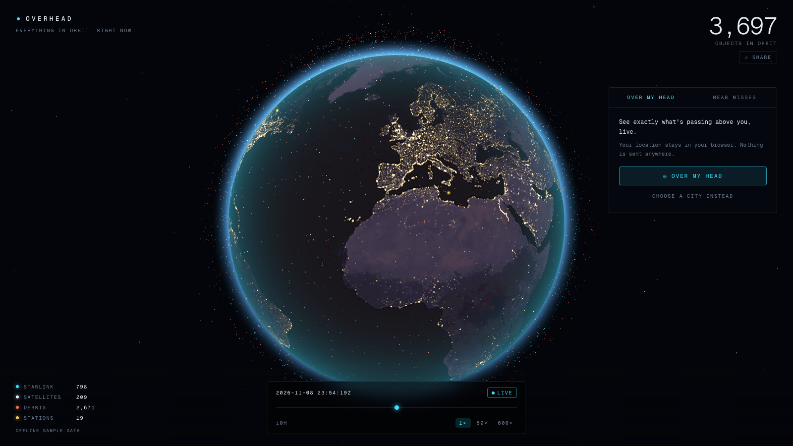
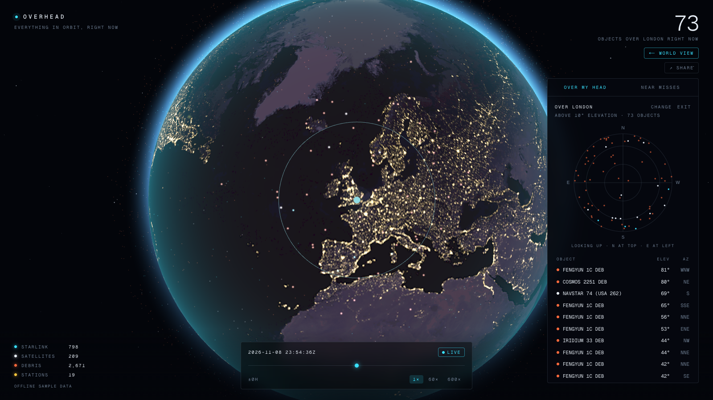
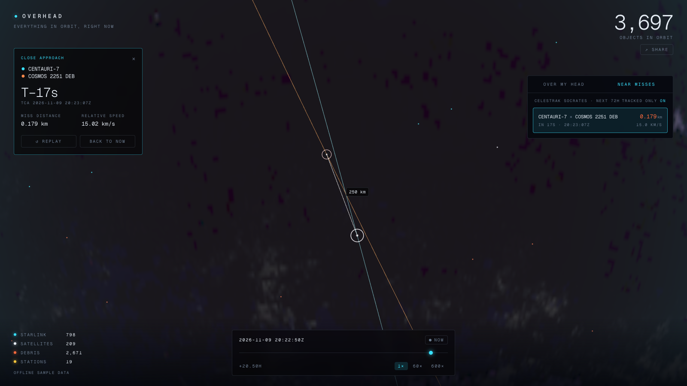
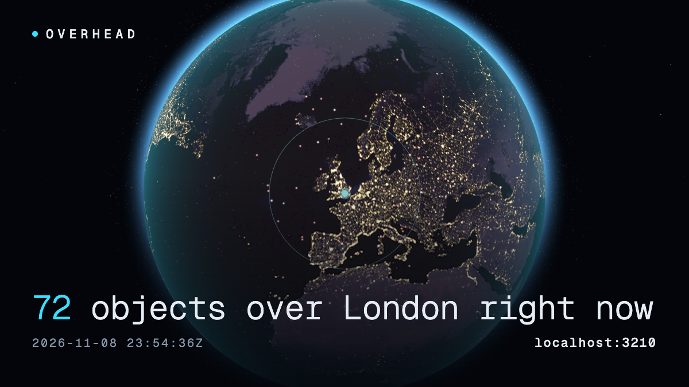
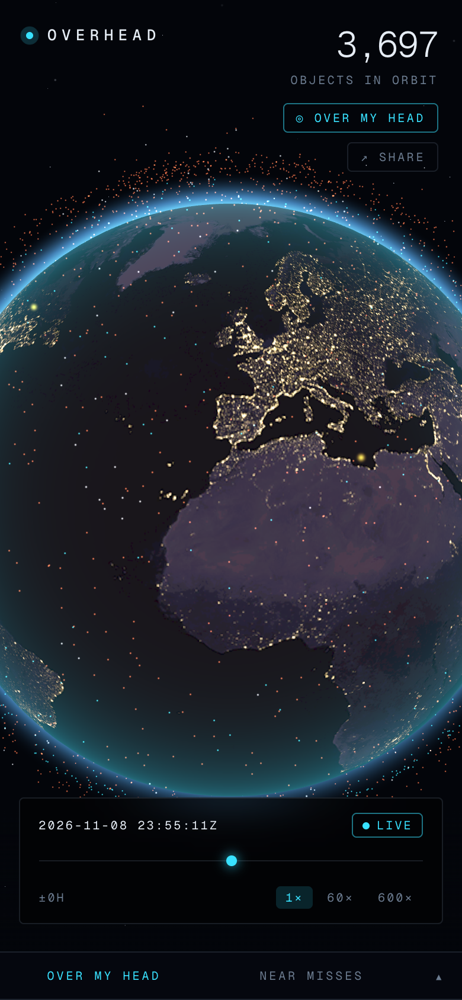
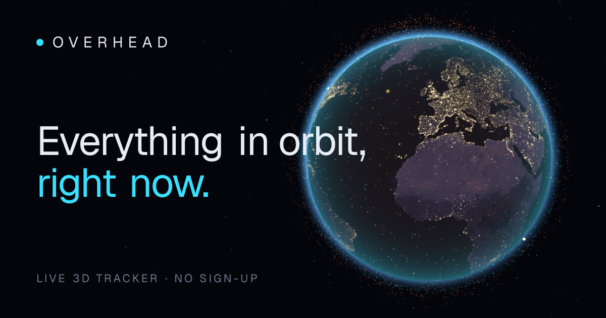
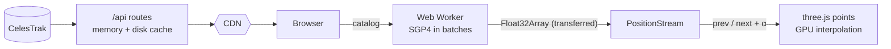

<div align="center">

# OVERHEAD

**Every satellite, Starlink train and piece of debris above you, live in your browser.**

*A project by [Aluinn McDonald](https://github.com/aluinn).*

[](https://github.com/aluinn/overhead/actions/workflows/ci.yml)
[](https://github.com/aluinn/overhead/actions/workflows/codeql.yml)
[](LICENSE)
[](https://github.com/aluinn/overhead/stargazers)
[](https://vercel.com/new/clone?repository-url=https%3A%2F%2Fgithub.com%2Faluinn%2Foverhead)

<!--
  HERO GIF PLACEHOLDER
  Record a ~8 s capture (intro fly-in → "Over my head" → click a near miss) and save it as docs/assets/hero.gif,
  then swap the image below for:  
-->


[**Deploy your own**](https://vercel.com/new/clone?repository-url=https%3A%2F%2Fgithub.com%2Faluinn%2Foverhead) · [Architecture](docs/ARCHITECTURE.md) · [Roadmap](ROADMAP.md) · [Contributing](CONTRIBUTING.md)

</div>

No API keys. No sign-up. Open it and the sky is already moving.

## Features

- **A dark, living Earth**: city lights on the night side, a terminator driven by the real sun position, a thin
  atmosphere glow, slow auto-rotate, and an intro fly-in.
- **19,000+ objects at 60 fps**: one GPU point cloud, coloured by type (Starlink cyan, debris orange, stations gold,
  everything else white) with ISS and Tiangong labelled.
- **Over my head**: share your location (or pick a city) and get a live count of objects above you, a polar sky plot
  and a list sorted by elevation. Your location never leaves your browser.
- **Starlink trains**: freshly launched strings of satellites are detected and labelled on the globe and in the list.
- **Click anything**: name, NORAD ID, altitude, speed, period, and a toggleable orbit trail.
- **Near-miss feed**: upcoming close approaches from CelesTrak SOCRATES. Click one and OVERHEAD time-travels to
  25 seconds before closest approach, frames both objects, draws both paths and a live separation line.
- **Time controls**: live by default; 1× / 60× / 600×, a ±24 h scrubber and a NOW button.
- **Share**: one click makes a clean 16:9 image with the headline stat (*"3,402 objects over London right now"*) and
  your URL as a watermark. Copy it, download it, or post to X.
- **Never blank**: layered caching and a bundled sample dataset keep it working when CelesTrak is down or rate-limiting.

| Over my head                      | Near miss                              |
| --------------------------------- | -------------------------------------- |
|   |  |

<details>
<summary>More screenshots</summary>

| Share image                           | Phone                                  | Social card                          |
| ------------------------------------- | -------------------------------------- | ------------------------------------ |
|  |       |   |

</details>

## How it works



1. **Data.** Orbital elements (GP/OMM JSON) come from [CelesTrak](https://celestrak.org) for `active`, `starlink`,
   `stations` and four debris groups; close approaches come from [SOCRATES Plus](https://celestrak.org/SOCRATES/).
   The browser never calls CelesTrak: Next.js route handlers fetch, validate and cache (memory, disk, CDN
   `s-maxage`), so CelesTrak sees roughly one request per group per few hours.
2. **SGP4.** [satellite.js](https://github.com/shashwatak/satellite-js) turns each element set into a position. All
   ~19,000 objects are propagated in a **Web Worker** in 4,096-object batches (≈ 9.5 ms per pass on an M1 Pro), once per
   second.
3. **Smooth motion.** The position buffer is transferred zero-copy between worker and main thread. The main thread
   keeps the previous and next snapshot and the **GPU interpolates between them** every frame, so 1 Hz physics looks
   like 60 fps motion.
4. **Everything else is derived from those same positions**: elevation/azimuth for the sky tab, Starlink train
   clustering, and picking, so the UI always agrees with what's drawn.

Deep dives: [Architecture](docs/ARCHITECTURE.md) · [Data sources](docs/DATA_SOURCES.md) ·
[Orbital mechanics](docs/ORBITAL_MECHANICS.md) · [Performance & benchmarks](docs/PERFORMANCE.md)

## Quick start

Requires **Node ≥ 22.6** (24 recommended).

```bash
git clone https://github.com/aluinn/overhead.git
cd overhead
npm install
npm run dev        # → http://localhost:3000
```

| Command             | Does                                  |
| ------------------- | ------------------------------------- |
| `npm run dev`       | Dev server                            |
| `npm run build`     | Production build                      |
| `npm run lint`      | ESLint                                |
| `npm run typecheck` | Strict TypeScript                     |
| `npm test`          | Vitest unit tests                     |
| `npm run test:e2e`  | Playwright smoke test                 |
| `npm run bench`     | Propagation benchmark                 |

### Deploy

Click **Deploy with Vercel** above, or import the repo at [vercel.com/new](https://vercel.com/new). There is nothing to
configure. Optionally set `NEXT_PUBLIC_SITE_URL` (see `.env.example`) if you use a custom domain.

### Embed

`?embed=1` collapses the UI to the globe and counter; see [`examples/embed.html`](examples/embed.html).

## FAQ

**Is it really live?**
The element sets are refreshed from CelesTrak every ~3 hours and SGP4 is evaluated against *your* clock, so positions
are current to roughly a kilometre (GP data degrades by ~1–3 km/day, so don't use this for collision avoidance; it's a
visualisation).

**Why does the legend say "OFFLINE SAMPLE DATA"?**
CelesTrak was unreachable or rate-limiting the server, so it is showing the bundled sample (~1,300 objects) instead of a
blank screen. It recovers automatically within minutes of the upstream coming back.

**Where does my location go?**
Nowhere. It's used in your browser to compute elevation angles and (optionally) remembered in your own
`localStorage`. The server never receives it.

**Why is the near-miss list short?**
SOCRATES screens the *whole* catalog; OVERHEAD only draws the objects in its groups, so by default the feed hides events
involving objects it can't show. Toggle **TRACKED ONLY** off to see everything. Docked pairs (e.g. ISS + Soyuz at 0 km/s)
are filtered out because they aren't near misses.

**Can I see a train right now?**
Only if one was launched recently: trains spread out over a few weeks. When one is detected it's labelled `TRAIN ×N`
on the globe.

**Does it work on my phone?**
Yes. The panel becomes a bottom sheet, and rendering is pixel-ratio capped. If WebGL is unavailable you'll get a message
rather than a blank page.

**Why the odd `satellite.js` build config?**
satellite.js 7 re-exports an optional WebAssembly API that bundlers can't follow. We only need its pure-JS SGP4, so
`next.config.ts` aliases the WASM entry points to a stub. Details in [`docs/ARCHITECTURE.md`](docs/ARCHITECTURE.md).

## Good first issues

Ready-to-file drafts live in [`docs/issues`](docs/issues). Good places to start:

| Draft | Label |
| ----- | ----- |
| [Elevation-mask slider](docs/issues/01-elevation-mask-slider.md) | good first issue |
| [Filter the list/radar by object type](docs/issues/02-kind-filter-chips.md) | good first issue |
| [Keyboard shortcuts](docs/issues/03-keyboard-shortcuts.md) | good first issue |
| [Grow the city list + tests](docs/issues/04-more-cities-and-search-tests.md) | good first issue |
| [Sun marker and twilight on the radar](docs/issues/05-sun-marker-on-radar.md) | good first issue |
| [Search by name / NORAD ID](docs/issues/09-object-search.md) | good first issue |
| [Pass predictions](docs/issues/06-pass-predictions.md) | enhancement |
| [Naked-eye visibility](docs/issues/07-naked-eye-visibility.md) | enhancement |
| [Shareable URL state](docs/issues/08-shareable-url-state.md) | enhancement |
| [PWA / offline cache](docs/issues/10-pwa-offline-cache.md) | enhancement |

## Roadmap

See [ROADMAP.md](ROADMAP.md). Next up: pass predictions, naked-eye visibility, shareable URLs and search.

## Credits

- **Orbital data: [CelesTrak](https://celestrak.org)** by Dr. T.S. Kelso: GP element sets and SOCRATES Plus. Please
  credit and [support them](https://celestrak.org/support/) if you build on this.
- [satellite.js](https://github.com/shashwatak/satellite-js) for SGP4, [three.js](https://threejs.org) for rendering
  (and the MIT-licensed Earth textures from its examples), [Next.js](https://nextjs.org) and [Tailwind CSS](https://tailwindcss.com).
- SGP4 reference: Hoots & Roehrich, *Spacetrack Report No. 3*; Vallado et al., *Revisiting Spacetrack Report #3*.

## License

[MIT](LICENSE) © Aluinn McDonald. Orbital data belongs to its providers; see [DATA_SOURCES](docs/DATA_SOURCES.md).
