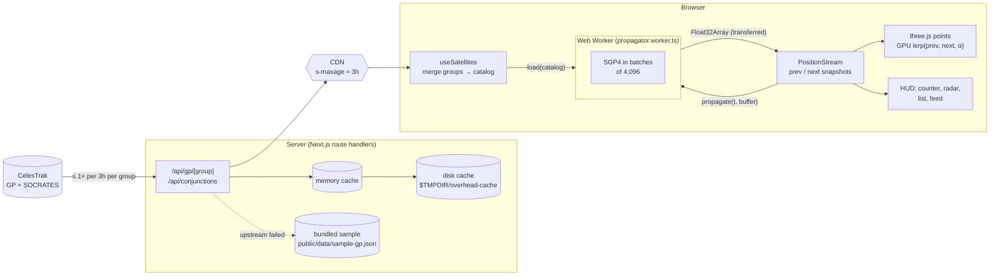

# Architecture

OVERHEAD is a Next.js (App Router) app with one idea at its core: **keep the main thread free**. Orbital
propagation runs in a Web Worker; the GPU does the per-frame interpolation; React only handles mounting and the HUD.

## Data flow



Key properties:

- **The browser never talks to CelesTrak.** Only the two route handlers do (see [DATA_SOURCES.md](DATA_SOURCES.md)).
- **One tick per second** (every 250 ms at 600×) the main thread asks the worker for positions *one tick in the
  future*; the GPU interpolates between the previous and next snapshot every frame, so motion is smooth at 60 fps
  while SGP4 runs at ~1 Hz.
- **Zero allocation in steady state.** The position buffer is *transferred* to the worker and back, then reused
  for the next request.

## One tick

```mermaid
sequenceDiagram
    participant R as requestAnimationFrame
    participant S as PositionStream (main)
    participant W as Worker
    participant G as GPU

    Note over S: every tickMs (1000, or 250 at 600×)
    S->>W: propagate { timeMs: now + tick, buffer } (transfer)
    W->>W: SGP4 for 20k objects in 4,096-object slices,<br/>yielding between slices
    W-->>S: { timeMs, buffer } (transfer back)
    S->>S: prev ← next; next ← buffer; version++
    loop every frame (60 fps)
        R->>S: alpha() = (clock.now − prevT) / (nextT − prevT)
        R->>G: uAlpha = alpha  (attributes re-uploaded only when version changed)
        G->>G: position = mix(aPrev, aNext, uAlpha) in the vertex shader
    end
```

## Why transferable buffers, not `SharedArrayBuffer`

The brief called for a shared `Float32Array`. A true `SharedArrayBuffer` needs cross-origin isolation
(`COOP: same-origin` + `COEP: require-corp`), which breaks third-party iframes/fonts and complicates the "embed it
anywhere" story. Transferring an `ArrayBuffer` back and forth is zero-copy, needs no special headers, and costs
nothing measurable at this size (234 KiB per snapshot at 20,000 objects). If a future feature needs concurrent
reads, the `PositionStream` boundary is the only place that would change.

## Worker protocol

`src/workers/messages.ts` is the single source of truth. Each message type has one entry in `Requests` and one in
`Responses`; the envelope types, the worker's handler table and the client's `call()` are all derived from them, so a
mismatch is a compile error.

| Message      | Request                                  | Response                       | Used for                                    |
| ------------ | ---------------------------------------- | ------------------------------ | ------------------------------------------- |
| `load`       | `{ objects }`                            | `{ count, valid, kinds }`      | Build SGP4 records for the merged catalog   |
| `propagate`  | `{ timeMs, buffer }`                     | `{ timeMs, buffer }`           | The per-tick position update                |
| `inspect`    | `{ index, timeMs }`                      | `{ info }`                     | Altitude, speed, lat/lon for the card       |
| `trail`      | `{ index, startMs, spanMs, steps }`      | `{ positions }`                | Orbit trail polylines                       |
| `pairState`  | `{ indexA, indexB, timeMs }`             | `{ state }`                    | Frame a close approach                      |
| `scan`       | `{ indices, startMs, … }`                | `{ events, scanned }`          | Fallback conjunction search                 |

## State

`src/store/runtime.tsx` creates one `Runtime` per page: the clock, the worker client, the position stream and a
~20-line observable store (`useSyncExternalStore`, no state library). The globe's render loop reads the store
non-reactively every frame; React components subscribe to slices.

Derived analysis runs off the renderer's own position snapshots, so there is no second source of truth:

- **Above you**: once per second, `computeVisible` filters the interpolated positions by elevation.
- **Trains**: every 5 s, `detectTrains` clusters Starlink satellites.

## Coordinate frames

Everything is drawn in an **Earth-fixed** frame, so the Earth mesh never rotates and city lights, the observer
marker and the sun direction stay put. The worker rotates SGP4's TEME output into ECEF using GMST, then writes
`scene = (X, Z, −Y) / R_earth`. Details in [ORBITAL_MECHANICS.md](ORBITAL_MECHANICS.md).

## Failure modes

| What breaks                         | What the user sees                                               |
| ----------------------------------- | ---------------------------------------------------------------- |
| CelesTrak returns 403 / times out   | Stale cache if we have one, else the bundled sample ("OFFLINE SAMPLE DATA" in the legend) |
| `/api/gp/*` unreachable (offline)   | Client fetches `/data/sample-gp.json` directly                   |
| SOCRATES unreachable                | Near-miss events computed in the worker over a subset ("COMPUTED IN YOUR BROWSER") |
| Geolocation denied / unsupported    | City / coordinates picker opens automatically                    |
| No WebGL                            | A plain message instead of a blank page                          |
| Clipboard API blocked               | "Use Download instead" message in the share dialog               |

## Folder map

```
src/
  app/              routes: page, layout, opengraph-image, api/{gp,conjunctions,health}
  components/
    globe/          Earth, Atmosphere, Starfield, SatellitePoints, OrbitTrail, ObserverMarker, Connector, labels, Globe
    hud/            CounterBadge, TimeControls, ObjectCard, ConjunctionCard, Legend, Panel, LocationPicker
    sky/            RadarPlot, OverheadList, SkyTab
    feed/           NearMissFeed, NearMissItem
    share/          ShareButton, captureImage
  workers/          propagator.worker.ts, messages.ts (typed protocol)
  lib/
    orbital/        propagate, lookAngles, trainDetection, conjunction, sun   (pure, unit-tested)
    data/           celestrak, socrates, parse, sample                         (server)
    geo/            geolocation, cityLookup
    three/          shaders, camera rig, picking, position stream, coords
    utils/          clock, rpc client, formatting, wasm stub
  hooks/            useSatellites, useObserver, useConjunctions, useClock, useWorker, useEmbedMode
  store/            store.ts (observable), runtime.tsx (context + state)
  types/            shared types
```
